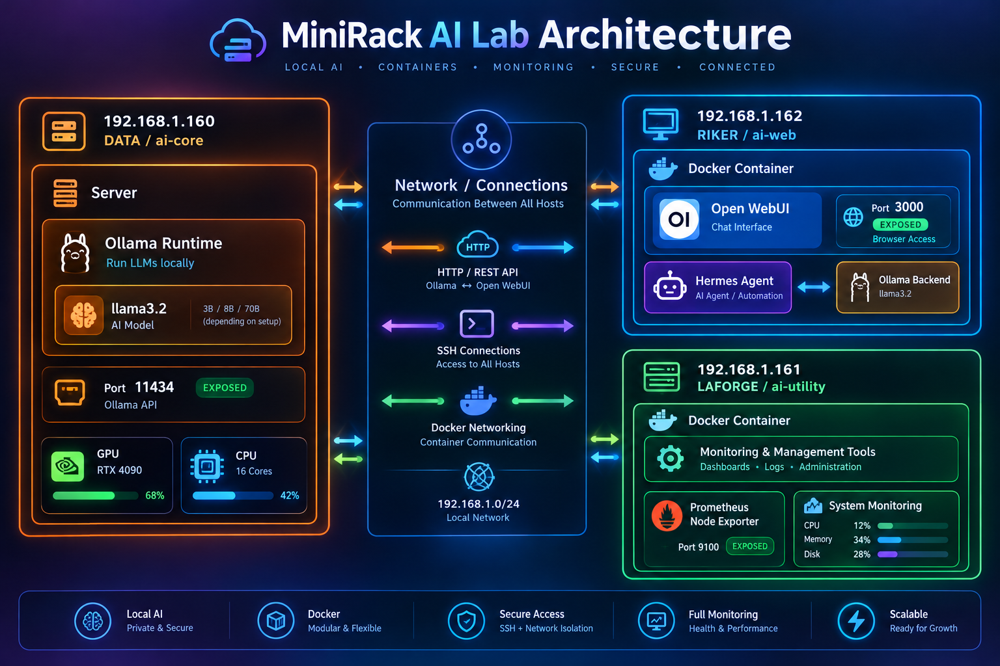

<p align="center">
  
</p>

# MiniRack AI Lab

This repository contains the Ansible automation used to prepare and deploy the MiniRack AI Lab environment.

## Architecture Overview

<p align="center">
  
</p>

The MiniRack AI Lab is a distributed AI computing environment across three specialized hosts:

- **ai-core (DATA - 192.168.1.160)** — Ollama LLM runtime with llama3.2 model
- **ai-web (RIKER - 192.168.1.162)** — Open WebUI interface and Hermes agent
- **ai-utility (LAFORGE - 192.168.1.161)** — Monitoring and management tools

All services communicate via REST APIs and SSH for a secure, modular architecture.

## Host Groups

The current inventory defines the following groups:

- `all` — all managed hosts
- `ai-core` — hosts the Ollama runtime and core AI workloads
- `ai-web` — hosts the web interface and AI harness services
- `ai-utility` — hosts supporting monitoring and management tooling

## Deployment Flow

The playbook is structured in three phases:

1. System preparation on all hosts
   - package patching and updates
   - base system configuration
   - SSH hardening

2. Ollama deployment on the `ai-core` group
   - the playbook imports the Ollama task file for the `ai-core` hosts

3. Docker deployment on the `ai-web` and `ai-utility` groups
   - Docker repository trust setup
   - Docker Engine and Compose install
   - Docker service enablement and startup

## Documentation

Before deploying, review the following documentation:

- **[Documentation Index](./documentation/INDEX.md)** — Overview of all available guides
- **[Security Guide](./documentation/SECURITY.md)** — Security hardening, SSH verification, and best practices
- **[Deployment Guide](./documentation/DEPLOYMENT.md)** — Step-by-step deployment instructions and troubleshooting

## Execution

From the repository root, run either of the following:

```bash
ansible-playbook -i inventory/servers.ini main.yml -u localadmin -k -K
```

or the repository helper script:

```bash
./scripts/ansible-execute.bash
```

Both flows prompt for:

- the SSH password for `localadmin`
- the sudo password for privilege escalation

## Pre-Deployment Requirements

Before running the playbook, you must:

1. **Accept SSH host keys** on all three target servers:
   ```bash
   ssh -o StrictHostKeyChecking=accept-new localadmin@192.168.1.160
   ssh -o StrictHostKeyChecking=accept-new localadmin@192.168.1.161
   ssh -o StrictHostKeyChecking=accept-new localadmin@192.168.1.162
   ```

2. **Configure Hermes installer checksum**:
   ```bash
   ./scripts/verify-hermes-checksum.sh
   ```
   Then update `config-files/config.yaml` with the actual checksum.

See [Security Guide](./documentation/SECURITY.md) and [Deployment Guide](./documentation/DEPLOYMENT.md) for complete details.

## Repository Layout

- `main.yml` — orchestration entrypoint
- `inventory/servers.ini` — host inventory and group mapping
- `tasks/system-updates.yaml` — package patching and reboot-related actions
- `tasks/system-config.yaml` — base system settings and SSH hardening
- `tasks/app-ollama.yaml` — Ollama deployment task file
- `tasks/app-docker.yaml` — Docker repository, install, and service setup
- `scripts/verify-hermes-checksum.sh` — Helper script to verify Hermes installer integrity
- `documentation/` — comprehensive guides and reference documentation

## Notes

- The playbook should be run from the repository root.
- The repository currently uses password-based SSH and sudo prompts, so the `-k` and `-K` options are required.
- SSH host key checking is enabled for security. You must pre-approve host keys before deployment (see Pre-Deployment Requirements above).
- Hermes installer verification is required. The checksum must be configured in `config-files/config.yaml` before deployment.